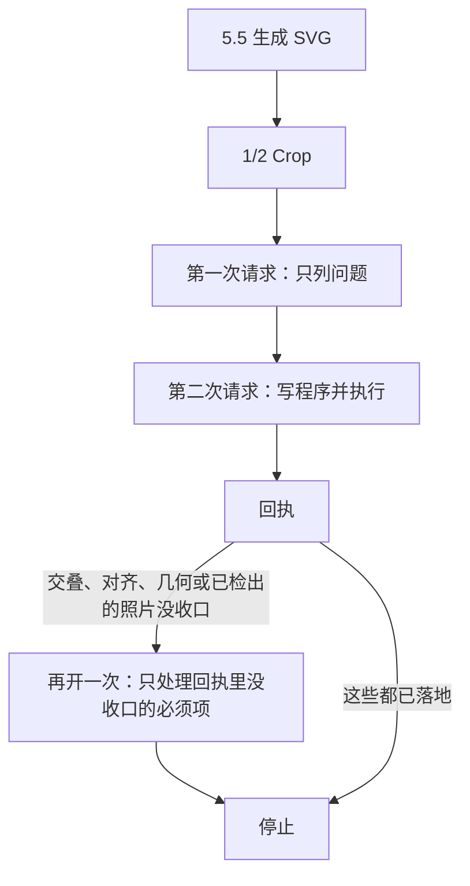

# FigFox

把论文插图从原图做成可编辑 SVG，再按原图检查并改回来。一条命令走完构图、裁切和修复。

Turn a paper figure into an editable SVG, then check it against the original and repair it. One command runs composition, crops, and repair.

这个文件夹只放能跑通这条流程的代码，以及程序会读进去的提示词。密钥、模型权重、运行结果和图片都不在这里。

This folder holds the code that runs that path, and the prompts the program reads. API keys, model weights, run outputs, and images stay out.

包名是 `figfox_plus`。仓库用短名 `figfox`。The package name is `figfox_plus`. The repository name is `figfox`.

## 流程

下面四步都在「运行」那一条 `chain` 命令里，按这个顺序做完。

1. **第一次构图。** GPT-5.5按原图写SVG；SAM开启时先取得图块、图标和箭头证据。P4构图规则来源为`prompts/first_native.md`，能力条件和共同质量规则见`docs/capabilities.md`。
2. **1/2 Crop。** 每个底框向左右上下各扩出自身宽、高的一半，裁在画布里面。同一块区域的原图和当前渲染并排放在一起。实现是 `src/figfox_plus/pack.py` 里的 `half_crop`，由 `src/figfox_plus/native/pack.py` 写成成对图片。检查阶段不会重新裁这些图。
3. **两次请求检查并修复。** 第一次只列问题，第二次为已经列出的问题写修复程序。类别是交叠、对齐、字体公式、规则立方体、箭头，以及和原图完全不符的小贴块。代码在 `src/figfox_plus/native/review_problem_first_v13/`。
4. **回执之后最多再请求一次。** 交叠、对齐、几何，或者已经检出但没落地的照片，才会打开这一次。已经落地的不再请求。这一次可以查看事先备好的全部 1/2 Crop，每一对第一张是原图、第二张是当前渲染，每条问题选定包含它的那一对再写程序。写完执行一次就停。

像素被改过，只说明程序执行了。这不等于图已经看过、可以接受。

真实API接入小样、已观察的视觉得失及尚未执行的80张实验见[验证状态](docs/validation-status.md)。

### 后段容量检查

线条事实表会把重复属性存一次，用列字典引用；每条记录、坐标和数值都保留。
每次 DeepSeek 请求（包括续接的推理和工具内容）在发送前估算容量，输出默认预留 64,000 token。续接时，对完全相同的历史输入使用接口已返回的真实用量，只估算新增内容；空间不足时停止，保留初次生成结果，不压缩输出预算、不截断证据、不自动重试。
每轮的 `model-turns/*/context-budget.json` 保存估算及决定。它不是提供方的精确 tokenizer，图片成本和文本成本都是估算，仍以接口实际计数为准。
默认上下文窗口 1,048,576 来自当前部署实际错误响应；更换部署时，通过 `FLOW_DS_CONTEXT_TOKENS` 设置真实窗口。`FLOW_DS_MAX_OUTPUT_TOKENS` 可调整期望输出预留。



回执续修实现在`src/figfox_plus/native/review_problem_first_v13/followup.py`；每次整链只调用一次GPT-5.5，不因视觉结果自动重跑。

## 准备

当前代码沙箱支持macOS的`sandbox-exec`，建议使用Python 3.12、Node和项目锁定的Playwright/Chromium。Python 3.14的vtracer兼容限制及已有浏览器、独立矢量Python的配置见[运行时安装](docs/runtime-setup.md)。

```bash
python -m venv .venv
source .venv/bin/activate
pip install -r requirements.txt
npm ci
npx playwright install chromium
```

密钥放在环境变量里，或用`FLOW_ENV_FILE=/path/to/existing.env`显式读取现有文件，不要提交到仓库；不会读取父目录或历史脚本里的密钥：

- `OPENAI_API_KEY`：第一次构图
- `DEEPSEEK_API_KEY`：两次检查
- `FLOW_ENV_FILE`：可选，现有凭据文件路径；进程环境变量优先
- `PLUS_PLAYWRIGHT_MODULE`、`PLUS_CHROMIUM`：可选，覆盖项目Playwright或其浏览器路径
- `PLUS_VECTOR_PYTHON`：可选，运行vtracer的Python；默认当前Python

第一步默认`gpt-5.5`、`medium`、最多32,768输出token，分别可用`FLOW_OPENAI_MODEL`、`FLOW_OPENAI_REASONING_EFFORT`、`FLOW_OPENAI_MAX_OUTPUT_TOKENS`显式配置；修复阶段默认`deepseek-flash`、`high`。失败或截断不自动重试，保留请求、原始流和已知/未知用量。

## SAM3

SAM默认开启，会请求本机`http://127.0.0.1:18080`的`POST /v1/segment/proposals`；可用`--sam-service-url`指定已有服务。权重不在仓库内。服务失败会在付费构图前退出，不会静默关闭SAM或切换付费服务；明确使用`--sam off`时不访问SAM服务或缓存。根路径404不能代替`/health`。

这条链路只发三类提示词：`picture`、`icon`、`arrow`。`adapters/raw_evidence.py` 里还有框、立方体等类别，`src/figfox_plus/sam.py` 不会把它们发给 SAM。

权重和 [DrawAI](https://github.com/Renaissance-Mind/DrawAI-dev) 用的是同一套 Meta SAM3：

- 检查点：ModelScope 或 Hugging Face 上 `facebook/sam3` 的 `sam3.pt`
- 词表：`bpe_simple_vocab_16e6.txt.gz`，来自 [facebookresearch/sam3](https://github.com/facebookresearch/sam3)

用 DrawAI 下载，并只启动 SAM3：

```bash
git clone https://github.com/Renaissance-Mind/DrawAI-dev
cd DrawAI-dev
uv run drawai setup local
uv run drawai server model sam3 --host 127.0.0.1
```

`setup local` 默认从 ModelScope 拉 `facebook/sam3`。走 Hugging Face 时要接受上游许可：

```bash
export HF_TOKEN=hf_...
uv run drawai setup local --source huggingface --accept-sam3-license
```

本机已经有权重时，指向那三个文件，不再下载：

```bash
uv run drawai setup local \
  --sam3-checkpoint /path/to/sam3.pt \
  --sam3-bpe /path/to/bpe_simple_vocab_16e6.txt.gz \
  --sam3-source /path/to/facebookresearch-sam3
```

听好之后：

```bash
curl http://127.0.0.1:18080/health
```

可选的fal.ai适配器会产生外部费用，需自行明确选择、配置`FAL_KEY`及安装`flask`、`fal-client`、`httpx`；链路不会自动启用它。默认端口8765，下例改为18080：

```bash
PORT=18080 python scripts/fal_sam3_adapter.py
```

去背景用的 RMBG2 权重不在本文件夹里，`chain` 不依赖它。相关代码在 `runtime/rmbg_runner.py`。

## 运行

在本目录执行这一条。它按上面的顺序走完：GPT-5.5 写 SVG，生成 1/2 Crop，DeepSeek 第一次只列问题，第二次写程序并在本机执行。交叠、对齐、几何，或已经检出但没落地的照片，才会再请求一次。

```bash
PYTHONPATH=src python -m figfox_plus chain \
  --image /path/to/figure.png \
  --id unet \
  --out /path/to/new-run \
  --sam on --code-methods on \
  --rerun-authorization your-one-time-string
```

跑之前先满足这些条件：

- Python、Node、Playwright和密钥已就绪；SAM-on还需真实SAM服务。
- `--image` 是原图 PNG，文件必须存在。
- `--id` 是短名字，只用字母、数字、`-` 和 `_`，例如 `unet`。
- `--out` 必须是一个还不存在的目录。结果写在这个目录里，不写回本文件夹。
- `--rerun-authorization` 是一次性字符串。同一张原图再次交给 GPT-5.5 时，换一个新的。

命令正常结束时，`chain-result.json`记录最终提交图与revision，`final/scene.svg`和`final/preview.png`包括已提交的条件续修结果；`chain-timing.jsonl`记录阶段时间。执行完成仍保持`visual_passed:false`，需要按原图另做视觉验收。

### 两项能力消融

| 条件 | 参数 | 含义 |
|---|---|---|
| S0C0 | `--sam off --code-methods off` | 原生SVG与模型自写stdlib Python修复 |
| S1C0 | `--sam on --code-methods off` | 上述路径加真实SAM素材/证据 |
| S0C1 | `--sam off --code-methods on` | 外接SVGplus/TP/裁图/取色等方法可用，无SAM |
| S1C1 | `--sam on --code-methods on` | 完整正式条件，计入四格一次 |

共同质量规则固定，能力清单、工具说明和SAM证据随条件改变，因此不声称完整提示词字节相同。代码off仍保留相同渲染、安全/写域和只读几何验收，禁用模型可调用的外接方法及自动修复。`invocation-trace.jsonl`记录真实调用；方法开启但未使用也如实记录。边界见[能力合同](docs/capabilities.md)。

[历史四格规划器](docs/ablation-plan.md)只验证80个历史ID/源图哈希并生成320项计划，不启动付费调用。全量运行还需真实SAM条件及单独冻结的累计费用预算；单图`chain`命令不提供跨320格的费用总控。

`chain` 是这条已经接上的整链。`python -m figfox_plus run` 仍是旧入口，默认还会走另一套单次修复，不要拿它代替上面这条命令。
