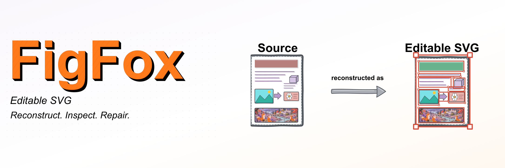
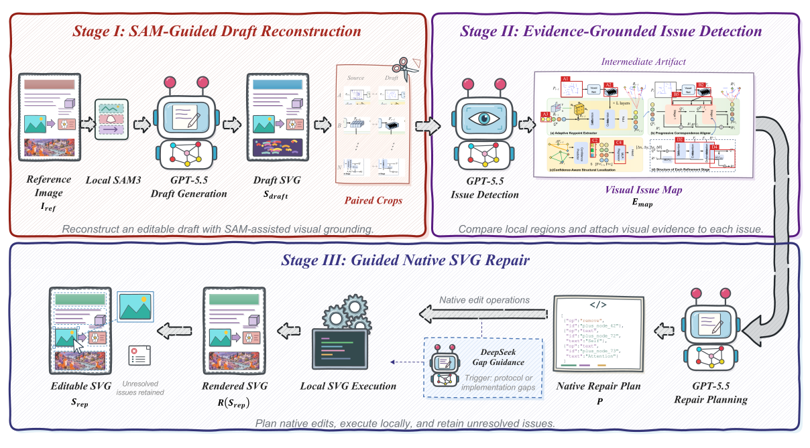
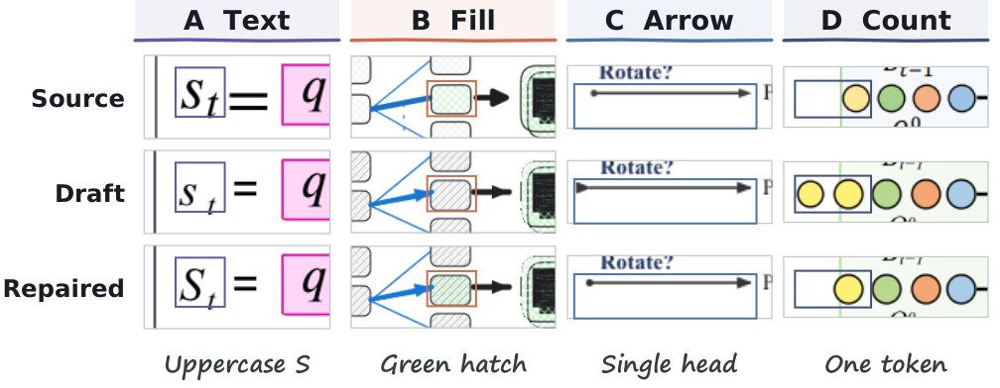

<p align="center">
  
</p>

<p align="center">
  <a href="#quick-start"></a>
  <a href="https://github.com/LawrenceRiver/FigFox/tree/main/skills/figfox"></a>
  <a href="https://github.com/LawrenceRiver/FigFox-Gen-skill"></a>
  <a href="https://huggingface.co/datasets/FigFoxBench/FigFoxBench-v3"></a>
  <a href="https://github.com/user-attachments/assets/012fad24-9536-4200-9219-1ad46e6083a8"></a>
  <a href="#architecture"></a>
  <a href="docs/README.zh-CN.md"></a>
</p>

---

FigFox turns a scientific figure into an editable SVG. You can change individual labels, shapes and connectors in an SVG editor. Photos and textures can remain embedded images. FigFox compares its draft with the source and applies local edits to the objects that differ.

## Skills

| Skill | Input → output | Install |
| --- | --- | --- |
| [FigFox](skills/figfox/SKILL.md) | Existing figure → editable SVG, with inspection and local repair | `npx skills@latest add LawrenceRiver/FigFox --skill figfox` |
| [FigFox-Gen](https://github.com/LawrenceRiver/FigFox-Gen-skill) | Methodology and optional references → new PNG | `npx skills@latest add LawrenceRiver/FigFox-Gen-skill --skill FigFox-Gen-skill` |

To edit a generated figure, select its PNG and invoke FigFox separately.

## Architecture



[Full-resolution architecture](docs/assets/framework-v80.png) · [Original SVG](docs/assets/framework-v80.svg) · [Harness details](docs/harness.md)

The API runner builds the draft (G0), compares it with the source (G1), then verifies the differences and plans edits (G2). Local tools apply the edits and render the result. The dashed DeepSeek branch in the diagram shows an earlier extension.

## See the reconstruction


The examples pair each source figure with its reconstructed SVG and show where individual objects changed. [View the examples as SVG](docs/assets/reconstruction-samples.svg).

<details>
<summary><strong>Look closer: text, fill, arrows and object counts</strong></summary>



The close-ups show changes to text case, fill, arrow direction and object count. [Open the detail view as SVG](docs/assets/semantic-targeting-details.svg).

</details>

## Quick start

Choose the **API runner** for configured model calls, or the [standalone Skill](#use-as-a-skill) to work inside your current assistant.

The runner supports macOS and Linux. Use Python 3.12 and Node 20+; install the Python and local rendering dependencies:

```bash
git clone https://github.com/LawrenceRiver/FigFox.git
cd FigFox
python3.12 -m venv .venv
source .venv/bin/activate
python -m pip install -r requirements.txt
npm ci
npx playwright install chromium
```

Set `OPENAI_API_KEY` in your shell and review the model and budget settings in [configs/factual.json](configs/factual.json). Running the command below makes paid model requests. Replace `reference.png` with your input image.

Start without a SAM service:

```bash
PYTHONPATH=src python -m figfox_plus factual \
  --image reference.png \
  --out runs/example \
  --config configs/factual.json \
  --no-sam
```

Open `final.svg` in an SVG editor and compare `final.png` with the source. The same directory also contains `result.json` and the stage records.

To reuse selected source regions with SAM3, follow the [optional service setup](docs/setup.md#optional-sam3) and omit `--no-sam`. For checkpoint recovery or draft-only output, see the [runner guide](docs/factual-pipeline.md).

## Use as a Skill

Install [FigFox](skills/figfox/SKILL.md) for reconstruction inside your assistant:

```bash
npx skills@latest add LawrenceRiver/FigFox --skill figfox
```

Provide an existing figure and invoke `$figfox`. It produces an editable SVG and a PNG preview, then supports inspection and local repair. The Skill uses the current assistant and local tools; it does not require a separate model API key or SAM service. See [installation and workflow](docs/skill.md).

For a new figure from Methodology and optional references, install [FigFox-Gen](https://github.com/LawrenceRiver/FigFox-Gen-skill):

```bash
npx skills@latest add LawrenceRiver/FigFox-Gen-skill --skill FigFox-Gen-skill
```

Invoke `$FigFox-Gen-skill` to produce a PNG. To obtain editable SVG, select that PNG and invoke `$figfox` separately. See the [generation Skill requirements](https://github.com/LawrenceRiver/FigFox-Gen-skill#installation).

## FigFoxBench

<!-- FIGFOX:BENCH:START -->
[FigFoxBench-v3 on Hugging Face](https://huggingface.co/datasets/FigFoxBench/FigFoxBench-v3) supports research evaluation of scientific-figure reconstruction. The dataset is private; access requires maintainer authorization and follows the [access policy](docs/figfoxbench-terms.md). See the [overview](docs/figfoxbench.md) for details.
<!-- FIGFOX:BENCH:END -->

## Video

<!-- FIGFOX:VIDEO:START -->
[Watch the FigFox demo](https://github.com/user-attachments/assets/012fad24-9536-4200-9219-1ad46e6083a8) (55 seconds). The demo follows a PNG through reconstruction, compares the SVG draft with the original, then edits a label and a shape’s fill before exporting the SVG.
<!-- FIGFOX:VIDEO:END -->

## Evaluation and source

The [evaluation guide](docs/evaluation.md) describes how FigFox assesses fidelity and editability. To inspect a result yourself, compare the rendered figure with its source and try editing the relevant text or shape in the SVG.

[Validation](docs/validation-factual.md) · [Release scope and licensing](docs/release-scope.md) · [Contributing](docs/contributing.md)

## Contributors

- [Honglin Liao / LawrenceRiver](https://github.com/LawrenceRiver) — project implementation and research.
- [高枫凯 · Gao Fengkai / QCYTSN](https://github.com/QCYTSN) — English prompt contributions; demo video coordination.
- [陈卓宣 · Chen Zhuoxuan / jason0917-eng](https://github.com/jason0917-eng) — FigFoxBench access documentation; dataset link coordination.
