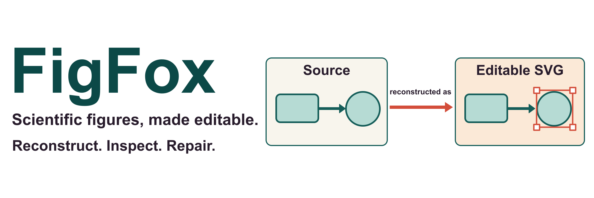
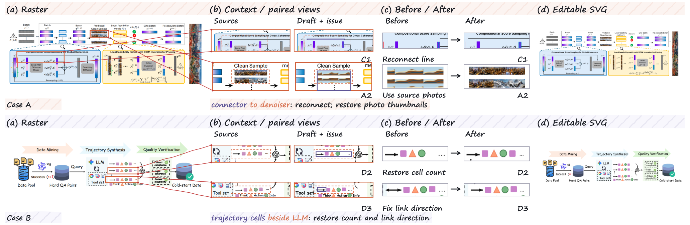

<p align="center">
  
</p>

<p align="center">
  <strong>From a scientific figure to an editable SVG.</strong><br />
  Preserve the content. Inspect the differences. Repair the right objects.
</p>

<p align="center">
  <a href="#quick-start">Quick start</a> ·
  <a href="#use-as-a-skill">Skill</a> ·
  <a href="#figfoxbench">FigFoxBench</a> ·
  <a href="#video">Video</a> ·
  <a href="docs/harness.md">Harness</a> ·
  <a href="docs/README.zh-CN.md">中文</a>
</p>

---

FigFox reconstructs an existing scientific figure as native SVG text, shapes, paths and groups. It then compares the rendered draft with the source and applies scoped local repairs. Photographs and textures can remain independent, embedded source crops; labels and diagram structure stay editable.

<table>
<tr>
<td width="33%"><strong>01 / Reconstruct</strong><br />Build one complete SVG draft, preserving layout, counts and directed relationships.</td>
<td width="33%"><strong>02 / Inspect</strong><br />Read the source and draft side by side. Keep evidence, uncertainty and close-up views explicit.</td>
<td width="33%"><strong>03 / Repair</strong><br />Bind confirmed differences to existing objects, apply native edits and render the result.</td>
</tr>
</table>

## See the reconstruction



Two selected examples from our manuscript: source figures, paired inspection views, matched repair details and reconstructed SVGs. They illustrate the workflow, rather than a guarantee of perfect reconstruction. [Original figure SVG](docs/assets/reconstruction-samples.svg)

<details>
<summary><strong>Look closer: text, fill, arrows and object counts</strong></summary>


These saved examples show how source evidence grounds a particular native SVG target. They are illustrative targeting cases, not a causal localization experiment. [Original figure SVG](docs/assets/semantic-targeting-details.svg)

</details>

<details>
<summary><strong>View the paper framework</strong></summary>


Original manuscript diagram, reused unchanged. Its dashed DeepSeek gap-guidance branch is a historical development extension, not a regular stage of the evaluated final repair path or the current default configuration. Evaluated runs use four quadrant pairs; the frame-expansion illustration is a separate extension. [Original framework SVG](docs/assets/framework-v80.svg)

</details>

## Quick start

Choose the **API runner** for configured model calls, or the [standalone Skill](#use-as-a-skill) to work inside your current assistant.

The runner supports macOS and Linux. Use Python 3.12 and Node 20+; install the Python and local rendering dependencies:

```bash
git clone https://github.com/LawrenceRiver/FigFox.git
cd FigFox
python3.12 -m venv .venv
source .venv/bin/activate
python -m pip install -r requirements.txt
npm ci
npx playwright install chromium
```

Set `OPENAI_API_KEY` in your shell. Review [configs/factual.json](configs/factual.json) before a live run: it explicitly records the models, endpoints, token limits, estimated prices and run-directory budget. All three stages use the all-GPT configuration; provider availability and billing must be checked before use.

Start without a SAM service:

```bash
PYTHONPATH=src python -m figfox_plus factual \
  --image reference.png \
  --out runs/example \
  --config configs/factual.json \
  --no-sam
```

The output directory contains `final.svg`, `final.png`, `result.json`, stage artifacts and request receipts. Execution success and visual fidelity are recorded separately.

For SAM-assisted source-asset reuse, [connect an existing local SAM3 service](docs/setup.md#optional-sam3), then omit `--no-sam`. See [runner details](docs/factual-pipeline.md) for hash-verified checkpoints, draft-only controls and interrupted-request recovery.

## Use as a Skill

The Skill uses the calling assistant for reconstruction, inspection and repair planning, with bundled local tools for rendering and scoped SVG edits. It needs no separate model API key or SAM service.

```bash
npx skills@latest add LawrenceRiver/FigFox --skill figfox
```

Then attach your figure and ask:

> Use $figfox to reconstruct this figure as an editable SVG. Preserve native text and shapes, keep photos as independent images, compare the rendered draft with the source, and verify actual edits before delivery.

[Skill entry](skills/figfox/SKILL.md) · [Installation and workflow](docs/skill.md) · [Editable architecture example](https://github.com/LawrenceRiver/FigFox-Gen-skill/tree/main/examples/v2-architecture/editable)

[FigFox-Gen](https://github.com/LawrenceRiver/FigFox-Gen-skill) generates a new raster figure from Methodology. FigFox reconstructs a selected existing figure. These are separately invoked workflows.

## FigFoxBench

<!-- FIGFOX:BENCH:START -->
[**FigFoxBench-v3 on Hugging Face →**](https://huggingface.co/datasets/FigFoxBench/FigFoxBench-v3)

Our benchmark collection contains **100 paper-extracted scientific figures**, grouped into four FC-adapted visual-clutter bins of 25 figures. The current dataset repository is private; access requires authorization from its maintainers. The 100-figure collection is distinct from the historical 80-figure ablation cohort.

GitHub contains the [dataset overview](docs/figfoxbench.md) and [access policy](docs/figfoxbench-terms.md), rather than a mirror of the image collection. Current access is for noncommercial research evaluation, with commercial use and model training prohibited under the maintainers' policy, subject to independently granted third-party rights.
<!-- FIGFOX:BENCH:END -->

## Video

<!-- FIGFOX:VIDEO:START -->
**Demo video — being prepared.**

The walkthrough will show source input, SVG reconstruction, local repair, and actual text/shape editing. The verified playback link will be added here by [QCYTSN](https://github.com/QCYTSN).

[Demo publication guide](docs/media.md)
<!-- FIGFOX:VIDEO:END -->

## Evaluation and reproducibility

The [17-criterion registry](benchmark/figfox-score-v3/README.md) covers fidelity and editability. Current harness visual judgments, historical API receipts and human editing evidence are distinct sources. Unknown and not-applicable judgments remain explicit; a valid SVG or successful edit execution alone does not establish visual quality.

The historical 80-figure study compares Full, Without SAM, and Without repair. Full and Without repair share the exact same G0 draft; Without SAM uses a separately generated SAM-off draft. Checkpoint continuation time is distinct from a fresh run beginning with the source.

[Evaluation protocol](docs/evaluation.md) · [Offline validation scope](docs/validation-factual.md) · [Archive verifier](scripts/verify_ablation.py)

## Repository

```text
src/figfox_plus/             G0/G1/G2 runner and shared native implementation
prompts/                    reconstruction, inspection and repair instructions
runtime/ · adapters/        local rendering and source-asset support
configs/                    explicit provider and budget configurations
skills/figfox/              self-contained assistant Skill
benchmark/figfox-score-v3/   current criterion registry and numbering migration
tests/                      offline regression checks
docs/                       setup, harness, evaluation and collaboration
```

The source release includes the current runner, its shared native dependencies, the standalone Skill and offline checks. Full datasets are hosted separately; local run artifacts, credentials and weights stay outside Git.

[Release provenance and scope](docs/release-scope.md) · [Contributing](docs/contributing.md)

## Contributors

- [Honglin Liao / LawrenceRiver](https://github.com/LawrenceRiver) — project implementation and research.
- [Gao Fengkai / QCYTSN](https://github.com/QCYTSN) — English prompt contributions; demo video coordination.
- [Chen Zhuoxuan / jason0917-eng](https://github.com/jason0917-eng) — FigFoxBench access documentation; dataset link coordination.

Future video or dataset updates receive credit through their authors' own commits. See the [collaboration guide](docs/contributing.md).
