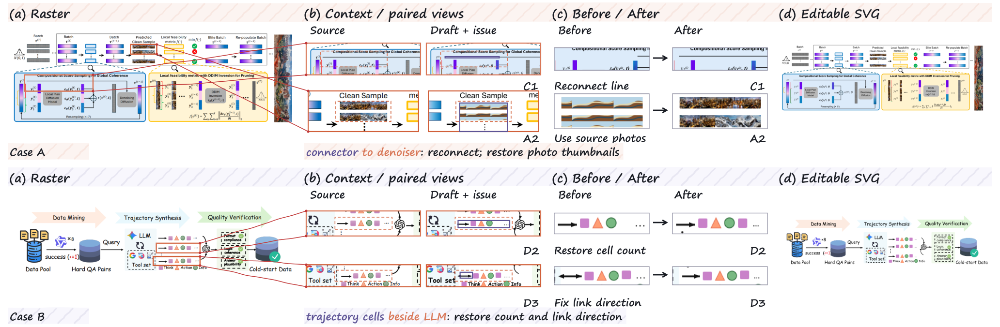

# FigFox

**把已有科研图重建为可编辑 SVG，再对照原图进行局部修复。**

文字、几何形状和连线保持原生 SVG；照片和纹理可保留为独立、可移动的内嵌素材。FigFox 先构建完整初稿，再成对检查原图与渲染结果，核实问题、定位对象并执行受限编辑。

## 真实案例

上图直接复用论文原图，展示原始图、成对检查、修复细节和可编辑结果。[原始 SVG](assets/reconstruction-samples.svg)。[更多局部修复细节](assets/semantic-targeting-details.svg)与[方法原图](assets/framework-v80.svg)也保留为 SVG；方法原图中的 DeepSeek 虚线分支是历史扩展，当前默认配置不使用它。

## 两种使用方式

- **完整 API runner**：配置 G0 构建、G1 检查、G2 复核与修复规划，随后本地执行原生编辑。安装和命令见[英文首页](../README.md#quick-start)及[安装说明](setup.md)。当前默认使用全 GPT 配置，运行前核对模型、价格和预算。
- **Skill**：`npx skills@latest add LawrenceRiver/FigFox --skill figfox`，然后向当前助手提供原图并调用 `$figfox`。它使用当前助手的视觉与文件工具，不另接模型 API，也不要求 SAM 服务。见[技能说明](skill.md)。

## FigFoxBench 与演示

[FigFoxBench-v3](https://huggingface.co/datasets/FigFoxBench/FigFoxBench-v3) 包含 100 张论文图，按 FC-adapted 视觉杂乱度分成四组、每组 25 张；当前是私有数据集，需要维护者授权。它与历史 80 张消融实验不是同一项声明。访问条件与权利边界见[数据集说明](figfoxbench.md)和[访问政策](figfoxbench-terms.md)。

演示视频由高峰凯（QCYTSN）整理，确认公开播放链接后更新[首页 Video 区域](../README.md#video)。陈卓轩（jason0917-eng）负责数据集入口与说明更新。

## 发布范围

保留最新版可移植 runner、Skill、所需原生模块、提示词、配置、17 项标准及离线测试；移除旧研究快照、旧评分实现、旧架构留档与论文 PDF。原始实验回复、日志、私有图片、权重、密钥和大型视频不进入 Git。已有 Git 历史保留。

工具成功执行、视觉保真度与真实可编辑性分别验证，不把聊天中的 harness 判断写成独立人工或新 API 评测。[完整 harness](harness.md) · [评测口径](evaluation.md) · [发布溯源](release-scope.md) · [协作方式](contributing.md)
