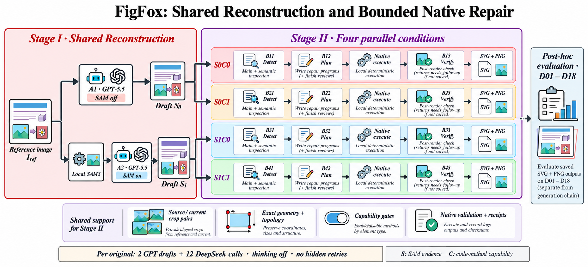

# FigFox bounded two-stage architecture · 2026-10-31

This is the execution protocol used for the completed historical80 generation cohort. It differs from the older multi-round native supervisor and the older `chain` command; those historical implementations remain identifiable rather than silently relabeled.

## Stage I: shared initial reconstruction

For each source image, GPT-5.5 produces two C-neutral initial reconstructions in parallel. A1 uses no SAM input (S0). A2 uses the existing local SAM3 source-bound catalog (S1). The same initial for a given S is reused by C0 and C1 only after source, capability, provenance and artifact checks. C does not change the initial generation prompt. Empty SAM output is a real recorded outcome, never a synthetic segmentation.

## Stage II: four independent branches

| Branch | Condition | Detection | Planning | Local step | Post-render verification |
|---|---|---|---|---|---|
| B1 | S0C0 | B11 | B12 | execute and render | B13 |
| B2 | S0C1 | B21 | B22 | execute and render | B23 |
| B3 | S1C0 | B31 | B32 | execute and render | B33 |
| B4 | S1C1 | B41 | B42 | execute and render | B43 |

S toggles SAM evidence. C toggles code-method/observation capabilities through native assignment policy; C0 retains the allowed baseline capabilities, rather than being a blanket prohibition on all local execution.

Detection combines main and semantic reports in **one** DeepSeek context. Planning uses the actual frozen finding queue, source/current crop evidence, current geometry and topology. If proposal reviews/localization were omitted by detection, the **same Bx2** request completes those duties and supplies the repair program. Native execution is local and does not add a model request. Bx3 judges the real post-execution render and native receipt; unchanged pixels or an empty plan do not constitute a successful repair.

Normal generation uses two GPT drafts and twelve DeepSeek requests per original, with DeepSeek thinking disabled. Explicit exceptional recovery calls in this cohort are separately named and costed; the diagram's normal count does not erase them. There is no hidden quality retry or verification-to-planning loop in this bounded protocol.

## Evidence and recovery

- Source/current full renders and context crop pairs remain available. Scoped planners receive exact current bounds, parent/ancestor relationships and source asset provenance; current coordinates are not claimed to be source crop coordinates.
- Read-only transport deduplication is lossless and inverse-checked. Native files, source hashes and validation are unchanged.
- Every attempt keeps its raw response, request identity, elapsed time, token usage and estimated cost. An uncertain request ID is not resent.
- Recovery continues verified checkpoints. Append-only native forks preserve original failed raw/receipt trees, pixel identities and path/hash migration records. Conservative dispositions never turn failed/unknown quality into a pass.
- Artifacts and receipts are saved even when the native state is `needs_followup`. Successful execution is distinct from visual quality and formal evaluation.

## Completion and costs

The generation cohort finished **80/80 originals and 320/320 native conditions** on 2026-10-31 (Asia/Shanghai). It produced 320 final SVGs and 320 PNGs, verified against native finish state and SHA256. Native visual-pass flags were **0/320**; this is a native disposition, not a formal D01–D18 score.

New successful calls in this two-stage cohort: 147 GPT calls (other initial records reused verified historical drafts) and 969 DeepSeek calls, including explicit exceptions. Configured-rate estimates: GPT USD42.562211 and DeepSeek USD11.669711976, **not a provider invoice**. Historical failed attempts and unresolved charge reserves remain separately retained. Each condition group's cumulative ceiling is USD169.933830, four groups USD679.735320; the older ledger has additional historical non-cohort entries and is not itself a new spending authorization.

## Post-hoc evaluation

Formal grading is outside the generation chain. The supplied **FigFox scoring standard v2**, D01–D18, is authoritative for both four-condition ablation and AFE/Crafter/DrawAI comparison. It has pass/fail/unknown/NA and critical-failure logic, not an invented 0–10 total. Model judgments remain unverified suggestions unless actual human evidence is provided. Static SVG structure cannot certify real editing, selecting/grouping, or a target-software save/reopen round trip. See [evaluation protocol](evaluation-unified-v2.md).

## Code and reproducibility boundary

The actual source snapshot is in [`research/two-stage-v1`](../research/two-stage-v1/README.md), including the bounded controller, provenance adapters and frozen native source. It is an **experiment snapshot**, with workstation bindings and archived request/cohort assumptions explicitly documented. It is not a claim that the older `chain` command has become this new controller. Dataset images, paid response logs, credential files, tokenizer/model weights and generated results are excluded. Reproduction needs explicit new workspace/runtime bindings and user-owned inputs; do not start a second paid queue over an existing cohort.
