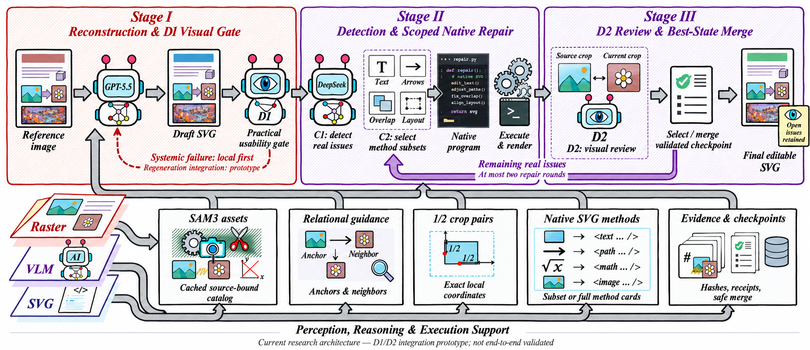

# FigFox: visual-gated reconstruction and scoped repair

Updated 2026-11-01 (Asia/Shanghai). This page describes the **current research architecture**, a single complete design rather than the experimental condition groups. It does not promote the prototype into a validated production pipeline.

## Complete intended chain

1. **Reference-grounded reconstruction.** Preserve the source image and provenance. Where source-bound visual assets are useful, use the existing SAM3 catalog. GPT-5.5 produces the initial editable SVG. A reused catalog must match the source hash, catalog hash and model signature.
2. **D1: practical initial acceptance.** Compare the rendered draft with the reference. Prefer continuing when defects are local and repairable. Escalate essential omissions, pervasive unreadable overlap, wrong main topology or corrupted scientific content. Decide local versus global regeneration, preferring local scope, and record whether SAM evidence is useful. The intended local-regeneration path calls the existing GPT generation capability, reuses verified SAM assets, then validates/merges the replacement. This entire adaptive execution path has **not** been demonstrated end to end.
3. **C1: identify and bind issues.** DeepSeek identifies necessary defects against actual source/current views and binds each issue to current SVG object IDs, context, and evidence. Harmless illustration, font or spacing differences are not automatically defects. An unsupported or ambiguous finding stays uncertain.
4. **C2: select existing repair methods.** Route confirmed issues to a subset or the full set of existing native method cards. Give each scoped worker the applicable instructions, exact target/neighbor geometry, parent relationships, styles, revision hash, and source/current half-window evidence. Do not invent a new repair backend or ask D2 to bypass the native program contract.
5. **Execute locally and render.** Validate the proposed program against capabilities, revision identity and target scope; execute it using the existing native methods. Preserve the unmodified surroundings, before/after checkpoints, hashes and receipts. A successful API response or local exit is not visual acceptance.
6. **D2: inspect, dispatch and stop.** D2 independently inspects the real result, identifies remaining practical defects and can dispatch an existing C2 subset again. C1 need not be rerun merely to repeat identification. The current bounded prototype allows at most **two repair rounds**, supports early stopping, and retains unresolved findings at the bound. A model cannot declare acceptance while its own required or uncertain issues remain unresolved.
7. **Select/merge a validated state and export.** Choose a registered checkpoint and validate any scoped merge against actual edits and unchanged surroundings. Preserve remaining issues in the delivery record. This is a bounded checkpoint/target mechanism, not a proven arbitrary semantic merge of any independently generated versions.
8. **Evaluate separately.** Save the SVG, PNG and execution evidence first. Independent grading is outside this generation chain; runtime practical gates do not become formal benchmark scores or a human sign-off.

```mermaid
flowchart LR
    I[Reference image] --> A[GPT-5.5 reconstruction]
    SAM[Verified source-bound SAM3 assets] --> A
    A --> D1[D1 practical initial gate]
    D1 -->|local defects can proceed| C1[C1 detect and bind issues]
    D1 -.->|systemic: local-first regeneration, prototype| A
    C1 --> C2[C2 existing method-card subsets]
    C2 --> N[Native validate, execute and render]
    N --> D2[D2 visual inspection]
    D2 -->|usable, early stop| M[Registered checkpoint selection / validated merge]
    D2 -->|remaining real issues; up to two rounds| C2
    D2 -->|bound reached: retain unresolved issues| M
    M --> O[SVG + PNG + receipts + remaining issues]
```

## Evidence and parallelism

- Half-window crops retain real pixel bounds and map explicitly into the current SVG viewBox. The source crop's coordinates are not silently treated as current SVG coordinates.
- Relative relationships govern scientific layout judgments. Exact current coordinates still bind a repair to the intended local object; these are different roles.
- Independent scoped jobs may run concurrently only after ancestor/descendant and read/write-neighbor conflict checks. Conflicting jobs are serialized. The parallel workers must join and revalidate revisions before a merge is accepted.
- Reuse caches and prior stages only with source, capability, provenance and artifact identity checks. Do not restart an entire run to conceal an integration error, resend an uncertain request ID, erase a failed attempt or reset accumulated costs.
- Human-assisted planning and inspection are not free autonomous model work. Report their presence and missing resource measurements explicitly.

## What has and has not been demonstrated

| Component | Current evidence boundary |
|---|---|
| Historical bounded generation controller | A distinct earlier cohort exists. It does not validate the newer D1/D2 route. |
| D1 systemic gate and route policy | Implemented policy and a same-route regeneration pilot. Adaptive local GPT regeneration with cached SAM reuse is not end-to-end validated. |
| Existing native repair/target guards | Reused by local repair trials, retaining native validation and revision checks. |
| D2-to-C2 method-subset dispatch | Isolated assisted trials exist; false-positive and contradictory-control risks remain. |
| Two-round acceptance and selection | Bounded policies and selected assisted examples; not a complete autonomous cohort validation. |
| File editing and portability | Must be tested in the chosen editor. Rendering alone does not prove semantic editing or a save/reopen round trip. |
| Formal benchmark and runtime claims | No new benchmark result, ranking, complete latest-architecture latency or cost claim is published here. |

The existing `chain` command remains the legacy implementation. This architecture illustration is **not** evidence that every arrow is already integrated into that executable. Unresolved execution or quality findings remain visible rather than being relabeled as passes.

## Publication boundary

The current experimental score tables, repaired outputs, accounting and reviewer archive are under internal review. **Do not upload or auto-publish them as part of this architecture update.** A local archive instruction or assistant-generated README is not permission for a future public release. Publication of those materials requires a separate explicit instruction from the human user after the experimental methodology and evidence have been reviewed.

Historical method documentation is retained at [bounded two-stage architecture](architecture-two-stage.md). The [evaluation protocol](evaluation-unified-v2.md) remains separate from practical runtime gates. No model ranking is asserted by this page.
